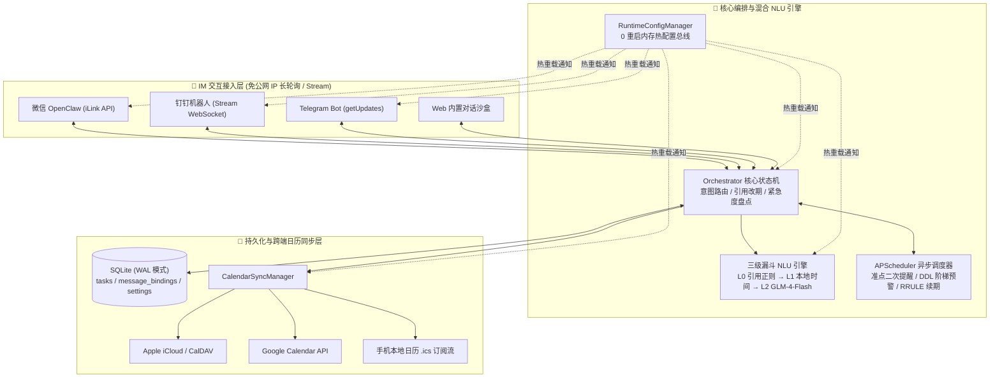

# ⏱️ Chrono Secretary —— 开源 AI 个人日程与 DDL 备忘录秘书

<p align="left">
  
  
  
  
  
  
</p>

> **“IM 即入口，日历即视图，对话即操作，闭环即秘书。”**
>
> **Chrono Secretary** 是一款轻量级、支持自托管（Self-Hosted）的开源 AI 个人日程与截止日期（DDL）管理秘书。通过接入 **微信（OpenClaw 官方 iLink 通道）/ 钉钉 / Telegram** 机器人发起自然对话，自动将事项同步至 **Apple iCloud 日历 / Google Calendar / 手机本地系统日历 (`.ics`)**，并在临近节点通过 IM 机器人主动发起**二次提醒**，支持直接**【引用回复】**机器人消息进行动态改期、顺延或销项。

---

## 🌟 为什么需要 Chrono Secretary？

市面上现有的待办工具（滴答清单、Todoist、Notion 等）普遍存在三大痛点：
1. **记录链路重**：需要专门解锁手机、打开 App、选日期、设闹钟，难以做到在微信/钉钉聊天时随手一句话记事。
2. **缺乏“日历原生响铃 + IM 强触达”双保险**：普通机器人只能在聊天框发一条消息，开会或锁屏时极易漏看；而单纯写日历又缺少交互式的催办与汇报。
3. **动态改期繁琐**：计划变动时，传统工具需要进 App 重新编辑时间；而在 **Chrono Secretary** 中，你只需在聊天窗口**直接「引用回复」机器人的提醒消息**说一句 *“推迟半小时”* 或 *“改到明天下午3点”*，系统日历与后台定时器即刻联动更新。

---

## ✨ 核心特性

### 1. 双引擎心智模型：日程提醒 (`Schedule`) + 截止备忘 (`DDL Memo`)
系统自动识别两类截然不同的时间管理心智：

| 维度 | 📅 日程提醒 (`schedule` · 某刻去做) | ⏳ 截止备忘 (`memo_ddl` · 某刻前交) |
| :--- | :--- | :--- |
| **适用场景** | 开会、拿快递、看牙医、健身（**在指定时间点发生的事**） | 交作业、报销单、项目结题（**在截止线前随时可完成的事**） |
| **自然语言示例** | `“30分钟后提醒我拿快递”`<br>`“提醒我每天早上9点喝水，并且重复提醒”` | `“半个小时后交作业截止”`<br>`“软件工程作业最晚11月5日23:59截止，提前半天提醒我”` |
| **提醒与预警策略** | **准点触发**：默认提前 `10分钟` 预提醒 + **到点准时响铃**；支持 RFC 5545 `RRULE` 周期重复 | **阶梯倒计时预警**：默认提前 `24小时`（1天）+ `12小时`（半天）阶梯催办；短时紧急 DDL 自动折半预警 |
| **欠账盘点汇报** | 归入常规今日/未来日程 | 询问 `“我还有什么事情没做”` 时，按 **🔥 24h 内极紧急 / ⚠️ 3天内临近 / 📌 远期规划** 分级汇报剩余时长 |

### 2. ↩️ 消息引用动态改期（Method A: Quote Reply · 0 模型成本）
当机器人发出「创建确认卡片」或「到点提醒消息」后，直接在微信/钉钉/Telegram 中**【引用/回复】**该条消息：
- **相对顺延**：回复 `“推迟半小时”`、`“延后2小时”`、`“推迟15分钟”` $\rightarrow$ 自动重算时间并同步更新远端日历与定时任务。
- **绝对改期**：回复 `“改到明天下午3点”`、`“改到周五10:00”` $\rightarrow$ 自动迁移日程节点。
- **一键销项**：回复 `“已完成”`、`“做好了”`、`“1”`、`“取消”` $\rightarrow$ 自动标记完成、移除后续提醒并清理日历事件。

### 3. 🧠 三级漏斗混合 NLU 引擎（0 Token 规则优先 + 免费小模型兜底）
- **L0 引用动作快速通道**：针对 `Quote Reply` 消息，纯本地正则提取推迟/改期/完成指令，**0 Token 消耗，<5ms 响应**。
- **L1 本地高频句式与时间引擎**：内置中文相对时间（*“半个小时后”*、*“3天后”*）、绝对日期与周期规则提取，断网或未配 API Key 也能稳定工作。
- **L2 轻量 LLM 槽位提取**：复杂口语自动调用 OpenAI 兼容接口（默认推荐官方永久免费的 **智谱 `GLM-4-Flash`**，同样支持 **DeepSeek / 通义千问 Qwen / 本地 Ollama**）。

### 4. 📱 三端 IM 机器人 + 三端日历全覆盖（免公网 IP）
- **微信官方 OpenClaw (`ClawBot`)**：基于腾讯 iLink Bot API (`ilinkai.weixin.qq.com`)，支持在 Web 后台直接生成二维码扫码绑定 + HTTP 长轮询收发，无需公网域名。
- **钉钉机器人 (`Stream` 模式)**：基于 WebSocket 长连接双向收发，内网穿透零配置。
- **Telegram 机器人 (`Long Polling`)**：基于 `getUpdates` 异步长轮询，支持原生 `reply_to_message` 引用检测。
- **全平台日历同步**：
  - **Apple iCloud / 通用 CalDAV**：支持 iCloud、Nextcloud、群晖 Calendar、飞书 CalDAV 双向读写删改。
  - **Google Calendar**：支持标准 Google Calendar API v3 事件同步。
  - **手机本地日历 `.ics` 订阅流**：零配置生成专属加密订阅链接，iOS / Android / HarmonyOS / Outlook / macOS 扫码或粘贴即可订阅，内置 `VALARM` 原生闹钟。

### 5. 🖥️ Linear / Vercel 极简黑白灰控制台（0 重启热重载）
- 采用无彩色块污染的 **Linear / Notion 极简黑白灰设计语言**。
- **全表单 700ms 防抖自动保存**：输入 API Key 或切换开关后自动落盘并广播至内存配置总线（`RuntimeConfigManager`），无需手动点保存，无需重启容器或进程。
- **4 重自动刷新任务看板**：切页即刷、发消息即刷、窗口聚焦即刷、后台 5 秒热轮询，告别手动按 `F5`。
- **内置 IM 对话与引用沙盒**：未配置外部机器人前，即可在网页右侧直接模拟发送自然语言与点击「引用改期」测试全链路逻辑。

---

## 🏗️ 系统架构图



---

## 📂 项目目录与文件总结

本项目采用高内聚、低耦合的分层架构，所有运行时敏感数据（API Key、机器人 Token、个人日程）均独立保存在本地 `data/chrono.db`（已被 `.gitignore` 严格排除，绝不上传版本库）。

```text
chrono-secretary/
├── backend/
│   ├── main.py                      # FastAPI 应用入口、Lifespan 生命周期管理、静态前端挂载
│   ├── api/
│   │   └── routes.py                # RESTful API 路由：配置热更新、微信扫码、任务 CRUD、沙盒模拟、ICS 订阅
│   ├── core/
│   │   ├── schemas.py               # 跨模块 Pydantic 数据契约、任务状态枚举、渠道/日历抽象基类 (ABC)
│   │   ├── config_manager.py        # 内存热配置单例总线 (RuntimeConfigManager)，支持回调监听与 0 重启生效
│   │   ├── database.py              # SQLModel + aiosqlite 异步数据库引擎 (WAL 并发模式) 与 3 张核心表定义
│   │   ├── repository.py            # 异步数据访问层 (Repository)：任务 CRUD、消息引用绑定、配置持久化
│   │   ├── nlu_engine.py            # 三级漏斗混合自然语言引擎 (L0 引用快筛 + L1 正则/dateparser + L2 大模型)
│   │   ├── orchestrator.py          # 核心业务编排器：处理日程创建、DDL 拆解、引用改期闭环与未完成事项分级盘点
│   │   └── scheduler.py             # APScheduler 异步调度器：负责准点提醒、DDL 阶梯预警与 RRULE 周期自动续期
│   ├── channels/
│   │   ├── manager.py               # 多渠道网关管理器：统一启停微信/钉钉/Telegram 适配器与热重载重连
│   │   ├── wechat_claw.py           # 微信 OpenClaw (腾讯 iLink API) 适配器：扫码登录、getupdates 长轮询、引用解析
│   │   ├── dingtalk_bot.py          # 钉钉机器人适配器：Stream 模式长连接、repliedMsgId 引用提取与主动推送
│   │   └── telegram_bot.py          # Telegram 机器人适配器：getUpdates 异步轮询、reply_to_message 引用识别
│   └── calendars/
│       ├── manager.py               # 跨平台日历同步管理器：并发分发事件创建、改期与删除指令
│       ├── caldav_provider.py       # Apple iCloud / 通用 CalDAV 双向同步器 (支持 VALARM 提醒与 RRULE)
│       ├── google_provider.py       # Google Calendar API v3 双向同步器
│       └── ics_generator.py         # 手机系统日历免配置 .ics (iCalendar RFC 5545) 订阅流生成器
├── frontend/
│   └── index.html                   # Linear 极简风格单页管理控制台 (Vue 3 + TailwindCSS，含自动保存与测试沙盒)
├── data/
│   └── .gitkeep                     # 运行时 SQLite 数据库挂载目录 (chrono.db 自动忽略，不进 Git)
├── test_all.py                      # 10 大核心场景全链路自动化验收测试套件
├── requirements.txt                 # Python 生产环境依赖清单
├── Dockerfile                       # 轻量级容器镜像构建文件 (python:3.11-slim)
├── docker-compose.yml               # Docker Compose 一键编排配置
├── .gitignore                       # Git 忽略规则（严格排除 *.db、.env 及一切密钥文件）
└── README.md                        # 项目说明文档
```

---

## 🚀 快速开始

### 方式一：本地 Python 启动（推荐开发与个人轻量使用）

```bash
# 1. 克隆仓库并进入目录
git clone https://github.com/your-username/chrono-secretary.git
cd chrono-secretary

# 2. 创建虚拟环境并安装依赖（推荐 Python 3.11 / 3.12）
pip install -r requirements.txt

# 3. 启动服务
python -m backend.main
```

启动成功后，直接打开浏览器访问：**[http://localhost:8000/](http://localhost:8000/)**

### 方式二：Docker Compose 一键部署（推荐服务器 / NAS 24小时运行）

```bash
docker compose up -d --build
```
- 容器启动后访问 `http://<服务器IP>:8000/` 即可进入可视化配置中心。
- 数据库文件自动持久化在宿主机 `./data/chrono.db`，升级镜像不丢失任何配置或日程。

---

## ⚙️ 可视化配置指南（全程网页操作，自动保存）

打开 `http://localhost:8000/` 后，所有改动会在 **停手 0.7 秒后自动保存并立即生效**：

### 1. 配置免费大模型（NLU 引擎）
1. 点击左侧导航 **「大模型与规则」** $\rightarrow$ 点击顶部的 **「智谱 GLM-4-Flash（免费推荐）」** 快捷预设。
2. 前往 [智谱开放平台 (bigmodel.cn)](https://open.bigmodel.cn/) 注册并复制 API Key，粘贴至输入框。
3. 点击右上角 **「测试连接」**，显示绿色延迟毫秒数即代表配置成功。
   *(注：即使不填 API Key，内置的 L0/L1 本地时间引擎依然可以独立解析常规日程、DDL 与引用改期)*

### 2. 接入聊天机器人（三选一或多开）
- **微信 OpenClaw (`ClawBot`)**：在 **「IM 机器人通道」** 中开启微信开关 $\rightarrow$ 点击 **「生成微信绑定二维码」** $\rightarrow$ 使用手机微信扫码确认，即可自动写入长效 `bot_token` 并启动长轮询。
- **钉钉机器人**：在钉钉开放平台创建企业内部机器人并开启 **Stream 模式**，将 `Client ID (AppKey)` 与 `Client Secret` 填入对应输入框即可。
- **Telegram Bot**：向 `@BotFather` 申请 `Bot Token` 填入即可自动建立轮询。

### 3. 绑定个人日历
- **最快方案（0 门槛手机日历订阅）**：直接点击页面左侧底部的 **「复制 .ics 链接」**，在 iPhone（设置 $\rightarrow$ 日历 $\rightarrow$ 账户 $\rightarrow$ 添加其他账户 $\rightarrow$ 添加已订阅的日历）或 Android 日历中添加该 URL，即可将所有日程与 DDL 自动同步至手机系统日历。
- **Apple iCloud 日历双向同步**：前往 [appleid.apple.com](https://appleid.apple.com) 生成一个「App 专用密码」，在 **「日历同步源」** 中开启 CalDAV 并填入 Apple ID 与专用密码即可。

---

## 💬 常用对话指令速查表

| 意图类型 | 你可以对机器人说的话 | 秘书执行的动作 |
| :--- | :--- | :--- |
| **创建单次日程** | `“30分钟后提醒我拿快递”`<br>`“明天下午3点提醒我开组会”` | 写入系统日历 + 提前 10 分钟预提醒 + 到点发消息响铃 |
| **创建周期日程** | `“提醒我每天早上9点吃维生素，并且重复提醒”`<br>`“每周五下午5点提醒我写周报”` | 生成 `RRULE` 循环日历事件 + 每次触发后自动续期下一次调度 |
| **记录 DDL 备忘** | `“半个小时后交作业截止”`<br>`“软件工程大作业最晚11月5日23:59截止，提前半天提醒我”` | 计入 DDL 备忘录 + 按阶梯（如提前 1 天、半天）主动发消息催办 |
| **盘点未完成事项** | `“我还有什么事情没做？”` / `“查待办”` / `“未完成”` | 按 **24h 内极紧急 / 3天内临近 / 远期** 排序汇报剩余倒计时 |
| **引用消息顺延** | *(引用机器人的提醒消息)* 回复：`“推迟半小时”` / `“延后2小时”` | **0 Token 消耗**，原任务顺延并同步修改远端日历与定时器 |
| **引用消息改期** | *(引用机器人的提醒消息)* 回复：`“改到明天下午4点”` | **0 Token 消耗**，迁移至新时间点并重置提醒 |
| **引用消息销项** | *(引用机器人的提醒消息)* 回复：`“已完成”` / `“1”` / `“取消”` | **0 Token 消耗**，标记完成/取消，移除后续提醒与日历事件 |

---

## 🧪 运行自动化测试

项目内置了覆盖 **Web 探活、动态热配置、双向自然语言日程、DDL 阶梯预警、引用推迟、引用改期、未完成盘点、销项清理、REST CRUD 与 `.ics` 日历流校验** 的 10 项端到端测试套件：

```bash
python test_all.py
```

---

## 🔒 隐私与安全声明

- **本地数据主权**：所有配置、API 密钥、IM 会话凭证与个人日程均存储在本地 `./data/chrono.db` 中，不会向任何第三方统计服务器发送数据。
- **Git 防泄漏保护**：仓库 `.gitignore` 已默认屏蔽 `data/*`、`*.db`、`.env*` 与凭证 JSON 文件，确保 `git add / commit / push` 时绝不会将您的个人隐私或密钥上传至 GitHub。

---

## 📄 开源协议

本项目基于 [MIT License](https://opensource.org/licenses/MIT) 协议开源，欢迎提交 Issue 与 Pull Request！
